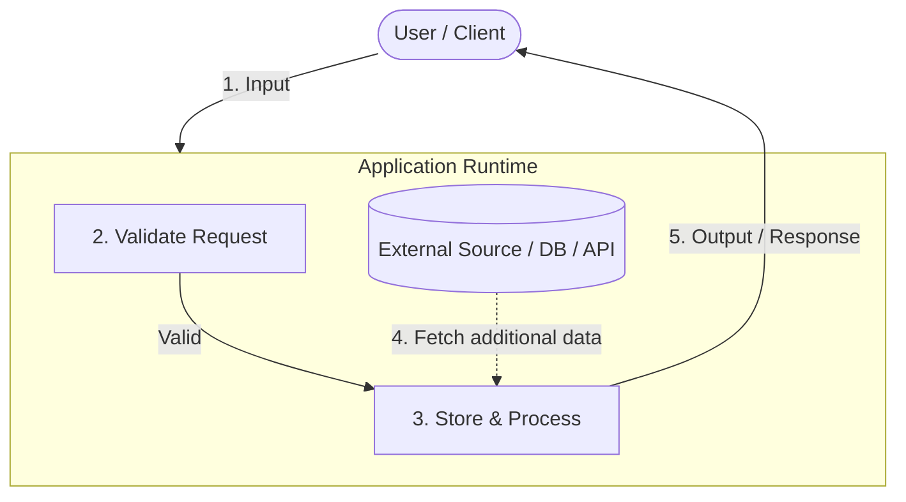
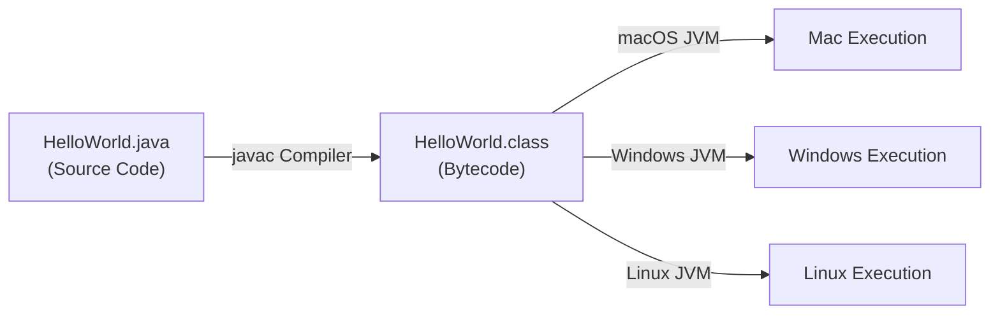

# Java Basics

A comprehensive foundation on what programming languages are, how Java executes code, the JVM / JRE / JDK ecosystem, and setting up an IDE (IntelliJ IDEA) to build and run Java applications.

---

## Table of Contents
1. [What is a Programming Language?](#1-what-is-a-programming-language)
   - [The Core Definition](#the-core-definition)
   - [Analogy: The Chai Order](#analogy-the-chai-order)
   - [Why Computers Need Formal Instructions](#why-computers-need-formal-instructions)
   - [Request Lifecycle Through a Computer](#request-lifecycle-through-a-computer)
   - [Where Java is Used in Industry](#where-java-is-used-in-industry)
2. [How a Java Program Runs](#2-how-a-java-program-runs)
   - [The Two-Phase Architecture: Compilation & Execution](#the-two-phase-architecture-compilation--execution)
   - [Source Code vs. Bytecode](#source-code-vs-bytecode)
   - [Platform Independence: Write Once, Run Anywhere (WORA)](#platform-independence-write-once-run-anywhere-wora)
   - [The Program Entry Point (`main` Method)](#the-program-entry-point-main-method)
3. [Understanding JDK, JRE, and JVM](#3-understanding-jdk-jre-and-jvm)
   - [Java Virtual Machine (JVM)](#java-virtual-machine-jvm)
   - [Java Runtime Environment (JRE)](#java-runtime-environment-jre)
   - [Java Development Kit (JDK)](#java-development-kit-jdk)
   - [Architectural Containment & Comparison](#architectural-containment--comparison)
   - [Historical Context](#historical-context)
4. [Setting Up IntelliJ IDEA & Running First Java Program](#4-setting-up-intellij-idea--running-first-java-program)
   - [IDE Installation](#ide-installation)
   - [Project Creation & Automated JDK Download](#project-creation--automated-jdk-download)
   - [Project Directory Structure (`src` vs `out`)](#project-directory-structure-src-vs-out)
   - [Writing & Executing `HelloWorld.java`](#writing--executing-helloworldjava)
   - [Decompilation & Inspecting Bytecode](#decompilation--inspecting-bytecode)
5. [Key Terms Glossary](#5-key-terms-glossary)
6. [Self-Assessment & Interview Revision Questions](#6-self-assessment--interview-revision-questions)

---

## 1. What is a Programming Language?

### The Core Definition

> **Programming Language:** A formal language used to write instructions that a computer can translate and execute.

Every term in this definition serves a specific technical function:
- **Formal language:** Unlike human languages (which tolerate ambiguity and slang), a programming language has strict syntax, keywords, and semantic rules that must be followed without syntax errors.
- **Write instructions:** You explicitly define the exact steps, transformations, inputs, and outputs required.
- **A computer:** The target hardware/operating system receiving the instructions.
- **Translate:** The computer or runtime environment translates human-readable source code into machine-executable instructions or bytecode.
- **Execute:** The machine performs the requested computational instructions.

### Analogy: The Chai Order

Consider walking into a cafe and ordering:
> *"I'd like a strong tea, but with less or no sugar."*

- The base preparation process (boiling water, infusing tea leaves, adding milk) represents the standard algorithm/program logic.
- The adjustable parameters (**strong**, **less or no sugar**) modify runtime behavior without rewriting the recipe.
- In programming, these customizable parameters and storage locations are called **variables**.

```java
// Conceptual mapping
int cups = 2;
boolean extraGinger = true;
System.out.println("Prepare chai order");
```

### Why Computers Need Formal Instructions

Computers are deterministic electronic machines. They cannot interpret subjective or ambiguous requests such as:
- *"Make this app professional."*
- *"Store this user nicely."*
- *"Show the latest course."*

A software engineer must translate these abstract desires into precise, unambiguous steps:
1. What data fields to validate.
2. How to persist them in memory or storage.
3. How to handle error cases and edge conditions.
4. How to format and return the response.

### Request Lifecycle Through a Computer

Every software application, from a simple command-line script to a distributed cloud microservice, processes requests through a standard flow:



1. **Input:** The user or calling service sends a request with parameters.
2. **Validate:** The system verifies correctness, format, authentication, and boundary conditions. Input is never trusted blindly.
3. **Store & Process:** Business logic executes, mutating state, performing calculations, or persisting data.
4. **Fetch:** If dependencies (database records, remote APIs) are needed, external resources are retrieved.
5. **Response:** The formatted result or error payload returns to the caller.

### Where Java is Used in Industry

Java remains a foundational language in enterprise computing:
- **Banking & Financial Infrastructure:** High-throughput, resilient transaction processing engines.
- **Enterprise Backends:** Mission-critical services requiring strict type safety, predictable performance, and long-term maintainability.
- **Cloud-Native Microservices:** Microservice ecosystems built on Spring Boot, Quarkus, or Micronaut.
- **Android Development:** Long standing foundation for native Android apps (now interoperable with Kotlin).
- **Large-Scale Platforms:** Core infrastructure at companies like Google, Netflix, Amazon, and LinkedIn.

---

## 2. How a Java Program Runs

### The Two-Phase Architecture: Compilation & Execution

In traditional compiled languages (like C/C++), source code is directly compiled into platform-specific machine code (e.g., x86_64 machine code for Windows or ARM64 machine code for macOS).

Java decouples compilation from hardware execution via a two-phase architecture:



#### Phase 1: Compilation
- **Tool:** `javac` (Java Compiler).
- **Input:** `.java` source file containing human-readable code.
- **Action:** Validates syntax, type safety, and language rules.
- **Output:** `.class` file containing **Java Bytecode**.

#### Phase 2: Execution
- **Tool:** `java` (JVM launcher).
- **Input:** `.class` bytecode file.
- **Action:** The JVM loads bytecode, verifies bytecode security/integrity, and executes it (via interpretation and JIT compilation to native machine instructions).
- **Output:** Program execution output.

```bash
# Terminal execution breakdown
# 1. Compile source into bytecode:
javac HelloWorld.java

# 2. Execute bytecode on JVM:
java HelloWorld
```

### Source Code vs. Bytecode

| Dimension | Source Code (`.java`) | Bytecode (`.class`) |
|---|---|---|
| **Audience** | Human developers | Java Virtual Machine (JVM) |
| **Format** | Plain text | Compact binary instruction set |
| **Platform Portability** | Universal text format | Universal binary format executed by any JVM |
| **Execution** | Cannot be run directly by CPU or OS | Executed by the platform-specific JVM |

### Platform Independence: Write Once, Run Anywhere (WORA)

- **The Bytecode is Platform-Independent:** The `.class` file generated on an Apple Silicon Mac is identical to the one compiled on an Intel Windows machine or an AMD Linux server.
- **The JVM is Platform-Dependent:** Each operating system and processor architecture has its own JVM implementation (e.g., Windows x64 JVM, Linux ARM64 JVM, macOS Apple Silicon JVM).
- **Result:** The platform-specific JVM shields the code from operating system quirks. You compile once, and the bytecode runs on any environment where a compatible JVM is installed.

### The Program Entry Point (`main` Method)

When the JVM launches an application, it must locate a deterministic starting point:

```java
public class HelloWorld {
    // Standard signature:
    public static void main(String[] args) {
        System.out.println("Hello, World!");
    }
}
```

- `public`: Accessible from anywhere, allowing the JVM runtime to invoke it.
- `static`: Can be invoked without creating an instance of the enclosing class.
- `void`: Does not return any value back to the OS upon normal return.
- `main`: The designated entry point method name sought by the JVM launcher.
- `String[] args`: Command-line arguments passed to the program.

*(Note: Newer Java versions such as Java 21+ introduce simplified instance main methods like `static void main()` or `void main()` in preview/unnamed classes for introductory education, but the standard `public static void main(String[] args)` remains the universal production entry point.)*

---

## 3. Understanding JDK, JRE, and JVM

Java's runtime and toolchain are organized into nested layers:

```text
+-------------------------------------------------------------------+
| JDK (Java Development Kit)                                        |
|                                                                   |
|   +-------------------------------------------------------------+ |
|   | JRE (Java Runtime Environment)                              | |
|   |                                                             | |
|   |   +--------------------------+  +-------------------------+ | |
|   |   | JVM                      |  | Libraries & Core Files  | | |
|   |   | (Java Virtual Machine)   |  | (rt.jar, java.base,     | | |
|   |   | - ClassLoader            |  |  utility classes)       | | |
|   |   | - Bytecode Verifier      |  +-------------------------+ | |
|   |   | - Execution Engine       |                              | |
|   |   +--------------------------+                              | |
|   +-------------------------------------------------------------+ |
|                                                                   |
|   Development & Diagnostic Tools:                                 |
|   - javac (Compiler)         - jar (Archiver)                     |
|   - java (Interpreter/Launcher) - javadoc (Documentation)         |
|   - jdb (Debugger)           - jconsole / jcmd (Diagnostics)      |
+-------------------------------------------------------------------+
```

### Java Virtual Machine (JVM)

The JVM is an abstract computing machine that provides the runtime execution environment for Java bytecode.

**Core Responsibilities:**
1. **Class Loading:** Reads binary `.class` representations and loads them into memory.
2. **Bytecode Verification:** Validates that instructions follow Java security constraints and do not attempt illegal memory or stack operations.
3. **Execution:** Converts bytecode into native host instructions via interpreter and JIT (Just-In-Time) compiler.
4. **Memory Management:** Allocates heap/stack memory and manages Garbage Collection (GC).

**Three Facets of JVM:**
- **Specification:** The official standard documentation detailing requirements for any conforming JVM implementation.
- **Implementation:** The actual software distributed by vendors (e.g., Oracle HotSpot, Eclipse OpenJ9, Amazon Corretto, Azul Zulu).
- **Runtime Instance:** The active operating system process created each time `java ClassName` is executed.

### Java Runtime Environment (JRE)

The bundle required to **run** compiled Java applications on end-user machines.
- **Formula:** `JRE = JVM + Core Standard Libraries + Supporting Files`
- Contains standard class libraries (such as `java.lang`, `java.util`, `java.io`).
- *Note:* Since Java 9 (Project Jigsaw / modularization), separate standalone JRE downloads are largely replaced by bundled application runtimes (via `jlink`) or standard JDK distributions.

### Java Development Kit (JDK)

The complete software kit required by software engineers to **develop, compile, debug, and run** Java programs.
- **Formula:** `JDK = JRE + Development Tools`
- Includes essential CLI tools:
  - `javac`: Compiles Java source files to `.class` bytecode.
  - `java`: Launches JVM processes.
  - `jar`: Packages multiple classes and assets into Java Archive (`.jar`) files.
  - `javadoc`: Generates HTML API documentation from code comments.

### Architectural Containment & Comparison

| Feature | JVM | JRE | JDK |
|---|---|---|---|
| **Full Name** | Java Virtual Machine | Java Runtime Environment | Java Development Kit |
| **Nature** | Abstract specification & runtime engine | Software package for execution | Full SDK for development |
| **Physical Existence** | Exists as an implementation executable & active process | Yes, installed filesystem folder | Yes, installed filesystem folder |
| **Contents** | ClassLoader, Memory areas, Execution Engine | JVM + Core Runtime Libraries | JRE + `javac`, `jar`, `javadoc`, debuggers |
| **Target Audience** | Abstract execution target | End users executing Java apps | Developers engineering Java apps |

### Historical Context
- Java was created by **James Gosling** and his team at **Sun Microsystems** (acquired by Oracle Corporation in 2010).
- The language was originally named **Oak** (after an oak tree outside Gosling's office). Because "Oak" was already trademarked by another company, the team renamed it **Java**.

---

## 4. Setting Up IntelliJ IDEA & Running First Java Program

### IDE Installation
- **IDE (Integrated Development Environment):** An integrated software suite combining a source code editor, build tools, compiler integration, debugger, and terminal in one interface.
- **Tool of Choice:** **IntelliJ IDEA** by JetBrains (Community Edition is free and provides full Java support; Ultimate Edition adds enterprise Spring tools).
- **Platform Selection:**
  - macOS: Download the build matching your processor architecture (**Apple Silicon** for M1/M2/M3/M4 or **Intel** for older Macs).
  - Windows / Linux: Standard 64-bit installers.

### Project Creation & Automated JDK Download
Modern IntelliJ releases allow automatic JDK management:
1. Select **New Project** $\rightarrow$ **Java**.
2. Assign project name: `HelloWorld`.
3. Set **Build system** to `IntelliJ` (or `Maven`/`Gradle` for build automation).
4. Under **JDK**, select **Download JDK** (choose an LTS or current release from vendors like Oracle OpenJDK, Eclipse Temurin, or Amazon Corretto).
5. Uncheck sample code to start with an explicit, clean canvas.

### Project Directory Structure (`src` vs `out`)

```text
HelloWorld/
├── .idea/                 # IDE project configuration metadata
├── src/                   # Source directory: human-readable .java source code
│   └── HelloWorld.java
└── out/                   # Output directory: compiler output
    └── production/
        └── HelloWorld/
            └── HelloWorld.class  # Generated bytecode
```

- `src/`: Where you write and maintain source code.
- `out/` (or `target/` in Maven, `build/` in Gradle): Directory created automatically by the compiler to hold `.class` bytecode artifacts.

### Writing & Executing `HelloWorld.java`

1. Inside `src/`, create a new Java class named `HelloWorld`.
2. Use IntelliJ live templates for speed:
   - Type `main` and press `<Enter>` $\rightarrow$ expands `main` entry point.
   - Type `sout` and press `<Enter>` $\rightarrow$ expands `System.out.println()`.

```java
public class HelloWorld {
    public static void main(String[] args) {
        System.out.println("Hello, World!");
    }
}
```

3. Click the green **Run** icon adjacent to the `main` method.
4. IntelliJ compiles `HelloWorld.java` using `javac`, emits `HelloWorld.class` into `out/`, and runs the JVM via `java HelloWorld`.

### Decompilation & Inspecting Bytecode
- If you open `HelloWorld.class` directly from the `out/production` folder in IntelliJ IDEA, IntelliJ automatically invokes its built-in decompiler (Fernflower) to show readable decompiled code.
- To inspect raw bytecode instructions directly from your terminal, use Java's class file disassembler:
```bash
javap -c out/production/HelloWorld/HelloWorld.class
```

---

## 5. Key Terms Glossary

- **Source Code:** Human-readable program instructions written in plain text files with the `.java` extension.
- **Bytecode:** The intermediate instruction set encoded in `.class` files, executable by any conforming JVM.
- **`javac`:** The standard Java compiler utility translating `.java` source code into `.class` bytecode.
- **JVM:** Java Virtual Machine; the runtime engine that executes bytecode on host hardware.
- **JRE:** Java Runtime Environment; the runtime library bundle and JVM needed to run Java programs.
- **JDK:** Java Development Kit; the developer toolkit containing the compiler, JRE, runtime, and development utilities.
- **Platform Independence:** The architectural quality allowing code compiled once to execute across heterogeneous OS architectures without modification.
- **WORA:** "Write Once, Run Anywhere" — the core philosophy of Java platform portability.
- **IDE:** Integrated Development Environment; software facilitating code editing, indexing, compilation, execution, and debugging.
- **`src` Directory:** The designated repository folder housing application source files.
- **`out` Directory:** The default directory where IDE build tools place generated bytecode artifacts.

---

## 6. Self-Assessment & Interview Revision Questions

### 1. In one sentence, what is a programming language?
> A formal language with strict syntax used to express instructions that a computer can translate and execute.

### 2. Why is a programming language termed a "formal" language?
> Because it adheres to rigorous, unambiguous syntactic and semantic rules, unlike natural human languages which allow colloquialism, vagueness, and inferred meaning.

### 3. What does `javac` produce from `HelloWorld.java`?
> It generates `HelloWorld.class`, a binary file containing platform-independent Java bytecode.

### 4. What are the two distinct phases that occur when clicking "Run" in Java?
> 1. **Compilation Phase:** `javac` checks syntax, semantics, and types, then compiles source code into bytecode.
> 2. **Execution Phase:** The JVM loads, verifies, and executes the bytecode on the target platform.

### 5. Is the JVM platform-dependent or platform-independent?
> **The JVM is platform-dependent.** Each operating system (macOS, Linux, Windows) and architecture (x86_64, ARM64) requires a JVM specifically compiled for that platform. However, the **bytecode it executes is platform-independent**, which is what enables Java applications to achieve WORA ("Write Once, Run Anywhere").

### 6. What is the mathematical relationship between JVM, JRE, and JDK?
> $\text{JRE} = \text{JVM} + \text{Core Libraries & Supporting Files}$  
> $\text{JDK} = \text{JRE} + \text{Development Tools } (\texttt{javac}, \texttt{jar}, \texttt{javadoc}, \text{debuggers})$

### 7. What was Java's original name and who developed it?
> It was originally named **Oak** by James Gosling and the Green Team at **Sun Microsystems** before being renamed Java due to trademark conflicts.
