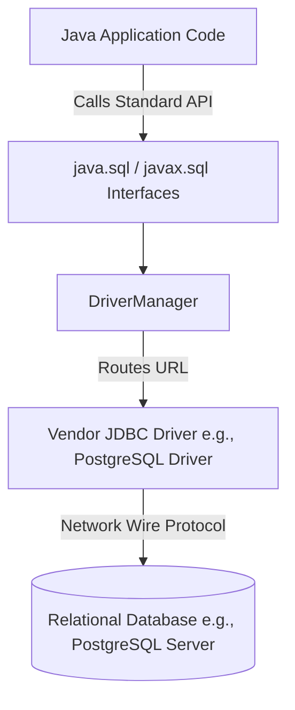
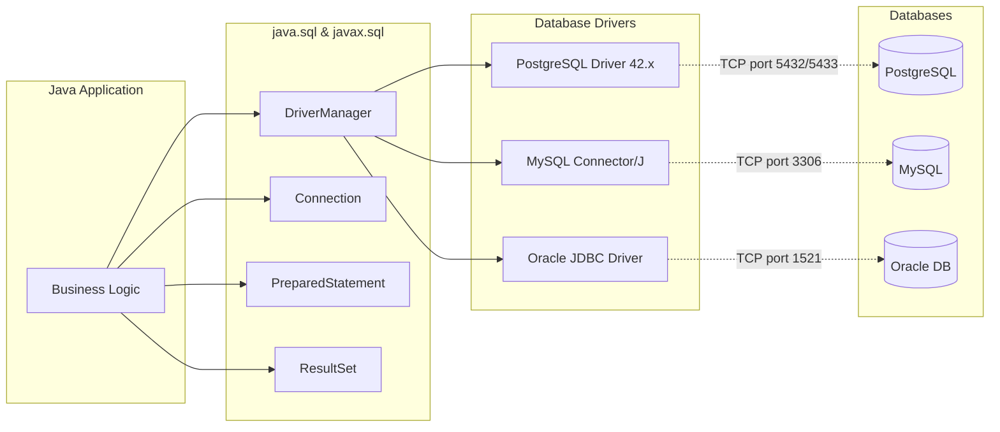
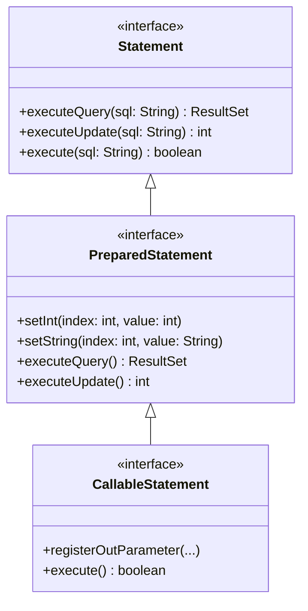
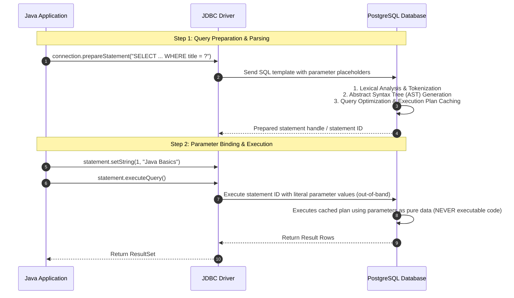
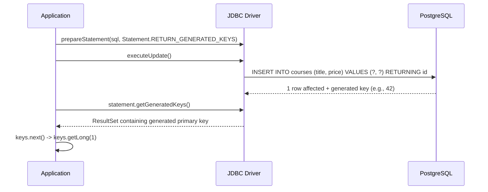
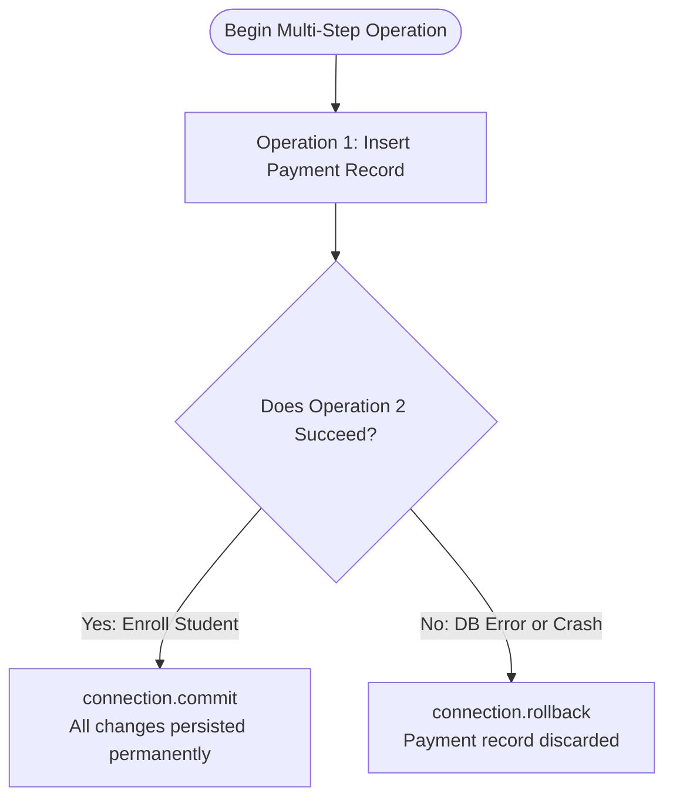
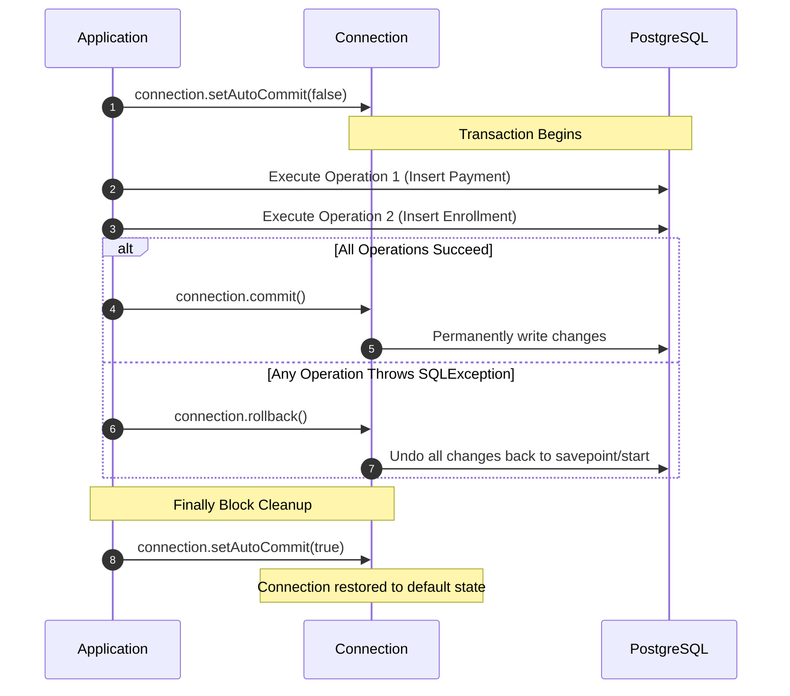
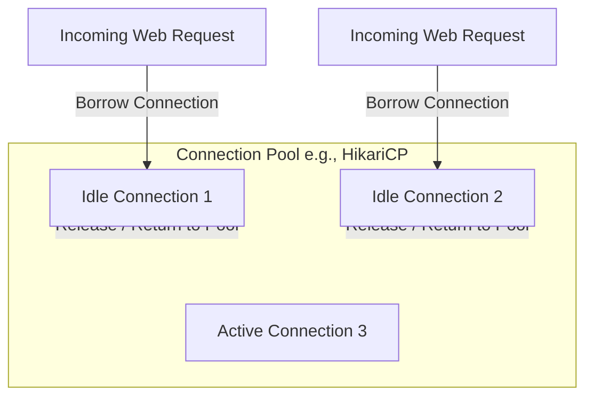
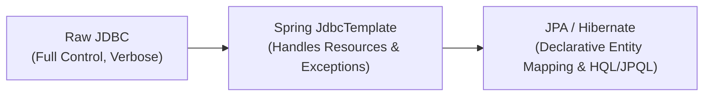

# Java Database Connectivity (JDBC)

A comprehensive guide and reference to Java Database Connectivity (JDBC), covering core architecture, driver management, connection lifecycles, query execution, result set mapping with Java Records, data mutations with auto-generated keys, and manual transaction control (ACID).

---

## Table of Contents
1. [Introduction to JDBC & Architecture](#1-introduction-to-jdbc--architecture)
   - [What is JDBC?](#what-is-jdbc)
   - [Why JDBC Exists: The Abstraction Layer](#why-jdbc-exists-the-abstraction-layer)
   - [The Core JDBC Architecture](#the-core-jdbc-architecture)
   - [JDBC Driver Types](#jdbc-driver-types)
   - [Modern Driver Loading via SPI (Java 6+)](#modern-driver-loading-via-spi-java-6)
   - [Maven Configuration (`pom.xml`)](#maven-configuration-pomxml)
2. [Connection Management & Metadata](#2-connection-management--metadata)
   - [JDBC URL Breakdown](#jdbc-url-breakdown)
   - [Establishing Connections with `DriverManager`](#establishing-connections-with-drivermanager)
   - [Resource Safety: Try-With-Resources & AutoCloseable](#resource-safety-try-with-resources--autocloseable)
   - [Inspecting Database & Driver Metadata](#inspecting-database--driver-metadata)
   - [Handling `SQLException`](#handling-sqlexception)
   - [Code Reference: `JdbcConnection.java`](#code-reference-jdbcconnectionjava)
3. [Executing Queries & Prepared Statements](#3-executing-queries--prepared-statements)
   - [The `Statement` Interface Hierarchy](#the-statement-interface-hierarchy)
   - [SQL Injection Vulnerability vs. Prepared Statements](#sql-injection-vulnerability-vs-prepared-statements)
   - [How `PreparedStatement` Works Internally](#how-preparedstatement-works-internally)
   - [1-Based Indexing in JDBC](#1-based-indexing-in-jdbc)
   - [Executing Queries via `executeQuery()`](#executing-queries-via-executequery)
   - [Code Reference: `JdbcStatement.java`](#code-reference-jdbcstatementjava)
4. [Processing Results & Object Mapping](#4-processing-results--object-mapping)
   - [Understanding `ResultSet` & Cursor Positioning](#understanding-resultset--cursor-positioning)
   - [Reading Columns: By Name vs. By Index](#reading-columns-by-name-vs-by-index)
   - [Handling Nullable Database Values](#handling-nullable-database-values)
   - [Mapping Relational Rows to Java 21 Records](#mapping-relational-rows-to-java-21-records)
   - [Accumulating Data into Collections](#accumulating-data-into-collections)
   - [Code Reference: `JdbcResults.java`](#code-reference-jdbcresultsjava)
5. [Data Mutations: INSERT, UPDATE, DELETE](#5-data-mutations-insert-update-delete)
   - [Mutating Data with `executeUpdate()`](#mutating-data-with-executeupdate)
   - [Comparison: `executeQuery()` vs `executeUpdate()` vs `execute()`](#comparison-executequery-vs-executeupdate-vs-execute)
   - [Inserting Data & Retrieving Auto-Generated Keys](#inserting-data--retrieving-auto-generated-keys)
   - [Updating Existing Records](#updating-existing-records)
   - [Deleting Records](#deleting-records)
   - [Code Reference: `JdbcMutations.java`](#code-reference-jdbcmutationsjava)
6. [Transaction Management & ACID Guarantees](#6-transaction-management--acid-guarantees)
   - [What is a Transaction? ACID Recap](#what-is-a-transaction-acid-recap)
   - [The Default Mode: Auto-Commit](#the-default-mode-auto-commit)
   - [Managing Manual Transactions: Demarcation Lifecycle](#managing-manual-transactions-demarcation-lifecycle)
   - [Implementing Commit and Rollback](#implementing-commit-and-rollback)
   - [The Critical `finally` Block: Restoring Auto-Commit](#the-critical-finally-block-restoring-auto-commit)
   - [Transaction Isolation Levels Overview](#transaction-isolation-levels-overview)
   - [Code Reference: `JdbcTransactions.java`](#code-reference-jdbctransactionsjava)
7. [Production Evolution: From Raw JDBC to Frameworks](#7-production-evolution-from-raw-jdbc-to-frameworks)
   - [The Drawbacks of Raw JDBC Boilerplate](#the-drawbacks-of-raw-jdbc-boilerplate)
   - [Connection Pooling (e.g., HikariCP)](#connection-pooling-eg-hikaricp)
   - [Spring `JdbcTemplate` & Object-Relational Mapping (ORM)](#spring-jdbctemplate--object-relational-mapping-orm)
8. [Key Terms Glossary](#8-key-terms-glossary)
9. [Self-Assessment & Interview Revision Questions](#9-self-assessment--interview-revision-questions)

---

## 1. Introduction to JDBC & Architecture

### What is JDBC?

> **JDBC (Java Database Connectivity):** A standard Java API (part of Java SE) that defines how Java applications connect to, interact with, and execute operations against relational database management systems (RDBMS) in a database-independent fashion.

JDBC is packaged within two core packages in the standard library:
- `java.sql`: Contains the primary interfaces and classes for core database connectivity (`Connection`, `Statement`, `PreparedStatement`, `CallableStatement`, `ResultSet`, `DriverManager`, `SQLException`).
- `javax.sql`: Provides enterprise and advanced capabilities such as connection pooling, distributed transactions (`XADataSource`), and disconnected rowsets.

### Why JDBC Exists: The Abstraction Layer

Before standard APIs like JDBC, applications had to write vendor-proprietary code to talk to databases (e.g., Oracle OCI, Sybase Open Client). Switching a database engine meant rewriting database interaction logic.

JDBC acts as an **abstraction contract**:
- **Application Layer:** Developers write code using standard Java interfaces (`java.sql.Connection`, `java.sql.PreparedStatement`, etc.).
- **Driver Layer:** Database vendors (PostgreSQL, MySQL, Oracle) implement these interfaces inside their proprietary driver JARs.
- **Database Layer:** The driver converts standard JDBC calls into the database's native wire network protocol.



### The Core JDBC Architecture

The JDBC architecture consists of two primary layers:
1. **JDBC API:** Provided by Oracle / OpenJDK. Defines the contracts that developers use.
2. **JDBC Driver Manager / Drivers:** Provided by the database vendors. Translates standard calls into vendor-specific network packets.



### JDBC Driver Types

Historically, JDBC drivers are categorized into 4 distinct types:

| Type | Name | Architecture | Characteristics & Use Cases |
|---|---|---|---|
| **Type 1** | JDBC-ODBC Bridge | Java $\rightarrow$ ODBC Bridge $\rightarrow$ Native DB Client | Deprecated and removed in Java 8. Requires ODBC setup on every client. Slow. |
| **Type 2** | Native-API Driver | Java $\rightarrow$ JNI $\rightarrow$ Native Client C/C++ Libraries | Requires native C libraries installed on each host. Difficult to deploy in portable containers. |
| **Type 3** | Network-Protocol Driver | Java $\rightarrow$ Middleware Server $\rightarrow$ Database | Translates JDBC calls to an intermediate application server protocol. Rarely used today. |
| **Type 4** | **Thin Driver (Pure Java)** | **Java $\rightarrow$ Direct Socket / Wire Protocol $\rightarrow$ Database** | **Industry Standard.** 100% pure Java. Ships as a single JAR (e.g., `postgresql-42.7.14.jar`). Connects directly over TCP/IP sockets to the database. Portable and fast. |

### Modern Driver Loading via SPI (Java 6+)

In early Java (JDBC 3.0 and older), developers were required to explicitly load the driver class into JVM memory using reflection before calling `DriverManager`:

```java
// Legacy approach (No longer needed since JDBC 4.0 / Java 6):
Class.forName("org.postgresql.Driver");
```

#### How Modern Driver Loading Works
JDBC 4.0 introduced automatic driver discovery using the Java **Service Provider Interface (SPI)** mechanism (`java.util.ServiceLoader`):
1. The driver JAR file includes a metadata file located at `META-INF/services/java.sql.Driver`.
2. Inside `postgresql-42.7.14.jar`, this file contains the fully qualified class name: `org.postgresql.Driver`.
3. When `DriverManager.getConnection(...)` is invoked, the `DriverManager` scans the classpath via `ServiceLoader` and automatically registers all available implementations of `java.sql.Driver`.

> [!TIP]
> You do **not** need `Class.forName()` in modern Java projects. Simply adding the driver dependency to your build file is sufficient.

### Maven Configuration (`pom.xml`)

In the project [`pom.xml`](file:///Users/md.kamranalam/Programming/sde_and_ai_ml/software_engineering/programming/java/jdbc/jdbc-demo1/pom.xml), Java 21 is configured along with the official PostgreSQL JDBC driver:

```xml
<project xmlns="http://maven.apache.org/POM/4.0.0"
         xmlns:xsi="http://www.w3.org/2001/XMLSchema-instance"
         xsi:schemaLocation="http://maven.apache.org/POM/4.0.0 http://maven.apache.org/xsd/maven-4.0.0.xsd">
    <modelVersion>4.0.0</modelVersion>

    <groupId>org.example</groupId>
    <artifactId>jdbc-demo1</artifactId>
    <version>1.0-SNAPSHOT</version>

    <properties>
        <maven.compiler.source>21</maven.compiler.source>
        <maven.compiler.target>21</maven.compiler.target>
        <project.build.sourceEncoding>UTF-8</project.build.sourceEncoding>
    </properties>

    <dependencies>
        <!-- Official PostgreSQL JDBC Type-4 Thin Driver -->
        <dependency>
            <groupId>org.postgresql</groupId>
            <artifactId>postgresql</artifactId>
            <version>42.7.14</version>
        </dependency>
    </dependencies>
</project>
```

---

## 2. Connection Management & Metadata

### JDBC URL Breakdown

A database connection string is a standardized URI format that tells the `DriverManager` which driver to select and where the database server is listening:

```text
jdbc:postgresql://localhost:5433/testdb
└┬─┘ └────┬───┘   └────┬────┘└─┬─┘ └──┬─┘
 │        │            │       │      └── Database Name
 │        │            │       └───────── Port (PostgreSQL default 5432; here 5433)
 │        │            └───────────────── Hostname / IP address
 │        └────────────────────────────── Sub-protocol (identifies driver)
 └─────────────────────────────────────── Main Protocol (always "jdbc")
```

- **`jdbc:`** Standard protocol identifying a JDBC connection request.
- **`postgresql:`** Sub-protocol identifying the target vendor driver.
- **`//localhost:5433/`:** Network socket address (host + port).
- **`testdb`:** Name of the logical database on that server instance.

#### Terminal CLI Equivalent:
```bash
psql -h localhost -p 5433 -U postgres -d testdb
```

### Establishing Connections with `DriverManager`

The [`DriverManager`](file:///Users/md.kamranalam/Programming/sde_and_ai_ml/software_engineering/programming/java/jdbc/jdbc-demo1/src/main/java/org/example/JdbcConnection.java#L17) class provides static utility methods to obtain a database connection:

```java
Connection connection = DriverManager.getConnection(DB_URL, DB_USERNAME, DB_PASSWORD);
```

Under the hood:
1. `DriverManager` iterates over registered `Driver` instances.
2. It asks each driver: `driver.acceptsURL(DB_URL)`.
3. The PostgreSQL driver returns `true` because the URL begins with `jdbc:postgresql:`.
4. The driver opens a raw TCP/IP socket connection to `localhost:5433`, completes the database handshake and authentication, and returns an instance of `java.sql.Connection` (specifically `org.postgresql.jdbc.PgConnection`).

### Resource Safety: Try-With-Resources & AutoCloseable

A database connection is a heavy, finite operating system resource:
- It maintains an open TCP socket.
- It consumes memory and worker thread allocations on the database server.
- Leaving connections unclosed leads to **connection leaks**, eventually causing `Too many connections` errors and bringing down production systems.

Because `Connection`, `Statement`, and `ResultSet` extend [`java.lang.AutoCloseable`](https://docs.oracle.com/en/java/javase/21/docs/api/java.base/java/lang/AutoCloseable.html), they should **always** be managed using Java's **try-with-resources** statement:

```java
try (Connection connection = DriverManager.getConnection(DB_URL, DB_USERNAME, DB_PASSWORD)) {
    // Perform operations
} // connection.close() is guaranteed to execute automatically here, even on exceptions
```

> [!IMPORTANT]
> Never manually call `.close()` in a standard `try-catch` block without a `finally` block or try-with-resources. If an exception occurs before `.close()`, the connection remains orphaned.

### Inspecting Database & Driver Metadata

JDBC provides the `DatabaseMetaData` interface to inspect the runtime characteristics, supported features, and environment information of the connected database:

```java
DatabaseMetaData metaData = connection.getMetaData();
System.out.println("Database Product: " + metaData.getDatabaseProductName());    // e.g., PostgreSQL
System.out.println("Database Version: " + metaData.getDatabaseProductVersion());// e.g., 16.2
System.out.println("Driver Name:      " + metaData.getDriverName());             // e.g., PostgreSQL JDBC Driver
System.out.println("Driver Version:   " + metaData.getDriverVersion());          // e.g., 42.7.14
```

### Handling `SQLException`

[`SQLException`](file:///Users/md.kamranalam/Programming/sde_and_ai_ml/software_engineering/programming/java/jdbc/jdbc-demo1/src/main/java/org/example/JdbcConnection.java#L22) is a checked exception thrown whenever a database access error or invalid operation occurs. It contains diagnostic properties:
- `e.getMessage()`: Human-readable error description.
- `e.getSQLState()`: Standardized 5-character ANSI SQL error code (e.g., `"23505"` for unique violation).
- `e.getErrorCode()`: Database vendor-specific integer error code.
- `e.getNextException()`: Chains subsequent exceptions if multiple database errors occurred in a batch.

### Code Reference: `JdbcConnection.java`

From [`JdbcConnection.java`](file:///Users/md.kamranalam/Programming/sde_and_ai_ml/software_engineering/programming/java/jdbc/jdbc-demo1/src/main/java/org/example/JdbcConnection.java):

```java
package org.example;

import java.sql.Connection;
import java.sql.DriverManager;
import java.sql.SQLException;

public class JdbcConnection {
    public static void main(String[] args) {
        String DB_URL = "jdbc:postgresql://localhost:5433/testdb";
        String DB_USERNAME = "postgres";
        String DB_PASSWORD = "admin123";

        /*
         * Terminal command - psql -h localhost -p 5433 -U postgres -d testdb
         */
        try (Connection connection = DriverManager.getConnection(DB_URL, DB_USERNAME, DB_PASSWORD)) {
            System.out.println("Connection: " + !connection.isClosed());
            System.out.println("Database: " + connection.getMetaData().getDatabaseProductName());
            System.out.println("Driver: " + connection.getMetaData().getDriverName());

        } catch (SQLException e) {
            System.out.println(e.getMessage());
        }
    }
}
```

---

## 3. Executing Queries & Prepared Statements

### The `Statement` Interface Hierarchy

JDBC provides three main interfaces for sending SQL statements to the database:



1. **`Statement`:** Used for simple SQL statements without dynamic parameters. Susceptible to SQL injection if parameters are concatenated.
2. **`PreparedStatement`:** Extends `Statement`. Pre-compiles SQL templates with parameter placeholders (`?`). Provides security, performance caching, and type safety.
3. **`CallableStatement`:** Extends `PreparedStatement`. Used to invoke stored procedures and functions that return OUT parameters.

### SQL Injection Vulnerability vs. Prepared Statements

#### The Vulnerable Pattern (`Statement` with String Concatenation):
```java
// DANGEROUS! NEVER DO THIS IN PRODUCTION:
Statement statement = connection.createStatement();
String userInput = "' OR '1'='1";
String sql = "SELECT * FROM courses WHERE title = '" + userInput + "'";
ResultSet rs = statement.executeQuery(sql);
```
The resulting SQL becomes:
```sql
SELECT * FROM courses WHERE title = '' OR '1'='1'
```
The condition `'1'='1'` evaluates to true for every single row, leaking entire tables or allowing malicious actors to append destructive commands (e.g., `'; DROP TABLE courses; --`).

#### The Secure Pattern (`PreparedStatement` with Parameter Binding):
```java
String sql = "SELECT id, title FROM courses WHERE title = ?";
try (PreparedStatement statement = connection.prepareStatement(sql)) {
    statement.setString(1, userInput);
    try (ResultSet result = statement.executeQuery()) {
        // Safe execution
    }
}
```

### How `PreparedStatement` Works Internally

When you prepare a statement, the database performs query processing in separate phases:



#### Why `PreparedStatement` Prevents SQL Injection:
Because the SQL structure is **parsed, validated, and compiled before parameters are supplied**, input values can never alter the query's Abstract Syntax Tree (AST). Even if a user enters `'; DROP TABLE courses; --`, the database treats the entire input string as a harmless literal search value.

### 1-Based Indexing in JDBC

Unlike traditional Java arrays and collections (which are 0-indexed), **JDBC parameter indices and column positions are 1-based**:

```java
statement.setString(1, title); // The first '?' is at index 1
```

> [!NOTE]
> JDBC followed SQL standards (SQL:1992 / SQL:1999) and ODBC conventions, where SQL collections and positional arguments are traditionally 1-based (`1, 2, 3...`). Passing `0` throws an `SQLException: Parameter index out of range (0 < 1)`.

### Executing Queries via `executeQuery()`

For queries that retrieve data (`SELECT`), invoke `statement.executeQuery()`:
- It returns an instance of `ResultSet`.
- Calling `executeQuery()` on non-SELECT statements (like `INSERT` or `UPDATE`) throws an `SQLException`.

### Code Reference: `JdbcStatement.java`

From [`JdbcStatement.java`](file:///Users/md.kamranalam/Programming/sde_and_ai_ml/software_engineering/programming/java/jdbc/jdbc-demo1/src/main/java/org/example/JdbcStatement.java):

```java
package org.example;

import java.sql.*;
import java.util.Scanner;

public class JdbcStatement {
    public static void main(String[] args) {
        String DB_URL = "jdbc:postgresql://localhost:5433/testdb";
        String DB_USERNAME = "postgres";
        String DB_PASSWORD = "admin123";

        try (Connection connection = DriverManager.getConnection(DB_URL, DB_USERNAME, DB_PASSWORD)) {
            Scanner sc = new Scanner(System.in);
            System.out.print("Enter a course title: ");
            String title = sc.nextLine();

            findCourseByTitle(connection, title);

        } catch (SQLException e) {
            System.out.println(e.getMessage());
        }
    }

    static void findCourseByTitle(Connection connection, String title) {
        String sql = "SELECT id, title FROM courses WHERE title = ?";

        // PreparedStatement and ResultSet both auto-close via try-with-resources
        try (PreparedStatement statement = connection.prepareStatement(sql)) {
            statement.setString(1, title);

            try (ResultSet result = statement.executeQuery()) {
                while (result.next()) {
                    long id = result.getLong("id");
                    String courseTitle = result.getString("title");
                    System.out.println(id + " - " + courseTitle);
                }
            }
        } catch (SQLException exception) {
            System.out.println(exception.getMessage());
        }
    }
}
```

---

## 4. Processing Results & Object Mapping

### Understanding `ResultSet` & Cursor Positioning

A `ResultSet` maintains a logical cursor pointing to its current row of data.

```text
Cursor Position               Row Data
[BEFORE FIRST ROW]   <--- Initial state right after executeQuery()
------------------------------------------------------------------
Row 1:               id = 1,  title = "Java Basics", price = 49.99  <-- 1st result.next() [returns true]
Row 2:               id = 2,  title = "Spring Boot", price = 99.99  <-- 2nd result.next() [returns true]
Row 3:               id = 3,  title = "PostgreSQL",  price = 29.99  <-- 3rd result.next() [returns true]
------------------------------------------------------------------
[AFTER LAST ROW]     <--- 4th result.next() [returns false, exits loop]
```

#### Key Rules:
- When a `ResultSet` is first created, its cursor is placed **before the first row**.
- Attempting to call getter methods (`getLong`, `getString`) before invoking `result.next()` throws an `SQLException: ResultSet not positioned on a valid row`.
- `result.next()` advances the cursor one row forward. It returns:
  - `true`: If the cursor is positioned on a valid data row.
  - `false`: If there are no more rows, which cleanly terminates a `while (result.next())` loop.

### Reading Columns: By Name vs. By Index

JDBC allows column extraction using two distinct styles:

```java
// Style A: By Column Label / Name (Recommended for maintainability)
long id = result.getLong("id");
String title = result.getString("title");
double price = result.getDouble("price");

// Style B: By 1-Based Column Index (Slightly faster, but fragile to SELECT changes)
long id = result.getLong(1);
String title = result.getString(2);
double price = result.getDouble(3);
```

| Criteria | By Column Name (`"title"`) | By Column Index (`2`) |
|---|---|---|
| **Readability** | High: Self-documenting code | Low: Requires counting projection fields |
| **Resilience** | High: Reordering `SELECT` columns does not break logic | Low: Changing column order in SQL causes type mismatches or runtime bugs |
| **Performance** | Minimal overhead (driver maintains a string-to-index lookup map) | Marginal micro-optimization (direct array offset lookup) |

### Handling Nullable Database Values

In SQL, columns can be `NULL`. In Java, primitive types (`long`, `double`, `boolean`) cannot hold `null`.
When a column value is `NULL` in the database, JDBC getters return default primitive values:
- `result.getLong(...)` returns `0L`.
- `result.getDouble(...)` returns `0.0`.
- `result.getBoolean(...)` returns `false`.

To check whether the database value was actually `NULL`, use [`result.wasNull()`](https://docs.oracle.com/en/java/javase/21/docs/api/java.sql/java/sql/ResultSet.html#wasNull()):

```java
double price = result.getDouble("price");
if (result.wasNull()) {
    // Column was actually SQL NULL in database
}
```

### Mapping Relational Rows to Java 21 Records

Modern Java (Java 16+) introduced **Records**, which are shallowly immutable data carriers. They are the ideal choice for Data Transfer Objects (DTOs) and tabular row projections in JDBC:

```java
record Course(long id, String title, double price) {}
```

#### Why Java Records Excel for JDBC Mapping:
- **Zero Boilerplate:** Automatically provides constructor, accessors (`id()`, `title()`, `price()`), `equals()`, `hashCode()`, and `toString()`.
- **Immutability:** Guarantees that query projections cannot be mutated accidentally downstream.
- **Compact Syntax:** Replaces 50+ lines of traditional JavaBean boilerplate with a single line.

### Accumulating Data into Collections

In enterprise code, methods should never leak database-specific `ResultSet` cursors outside their DAO/repository boundary. Instead, rows are extracted, transformed into domain models, and returned as standard Java collections (`List<T>`):

```mermaid
flowchart LR
    RS["ResultSet Rows<br/>(Database Cursor)"] -->|while result.next()| Map["Map Row to Record<br/>new Course(...)"]
    Map -->|list.add(course)| List["List<Course><br/>(Memory Collection)"]
    List --> Client[Caller / Service Layer]
```

### Code Reference: `JdbcResults.java`

From [`JdbcResults.java`](file:///Users/md.kamranalam/Programming/sde_and_ai_ml/software_engineering/programming/java/jdbc/jdbc-demo1/src/main/java/org/example/JdbcResults.java):

```java
package org.example;

import java.sql.*;
import java.util.ArrayList;
import java.util.List;

// Java 21 Record for clean DTO modeling
record Course(long id, String title, double price) {}

public class JdbcResults {
    public static void main(String[] args) {
        String DB_URL = "jdbc:postgresql://localhost:5433/testdb";
        String DB_USERNAME = "postgres";
        String DB_PASSWORD = "admin123";

        try (Connection connection = DriverManager.getConnection(DB_URL, DB_USERNAME, DB_PASSWORD)) {
            findAllCourses(connection);

        } catch (SQLException e) {
            System.out.println(e.getMessage());
        }
    }

    static void findAllCourses(Connection connection) {
        List<Course> courseList = new ArrayList<>();
        String sql = "SELECT id, title, price FROM courses";

        try (PreparedStatement statement = connection.prepareStatement(sql)) {
            try (ResultSet result = statement.executeQuery()) {
                while (result.next()) {
                    long id = result.getLong("id");
                    String title = result.getString("title");
                    double price = result.getDouble("price");

                    Course resultCourse = new Course(id, title, price);
                    courseList.add(resultCourse);
                }

                System.out.println("Course list: " + courseList);
            }
        } catch (SQLException e) {
            System.out.println(e.getMessage());
        }
    }
}
```

---

## 5. Data Mutations: INSERT, UPDATE, DELETE

### Mutating Data with `executeUpdate()`

For Data Manipulation Language (DML) statements (`INSERT`, `UPDATE`, `DELETE`) or Data Definition Language (DDL) statements (`CREATE`, `ALTER`, `DROP`), invoke:

```java
int affectedRows = statement.executeUpdate();
```

- **Return Value:** An `int` representing the number of rows modified, inserted, or deleted.
- For DDL statements (e.g., `CREATE TABLE`), it returns `0`.

### Comparison: `executeQuery()` vs `executeUpdate()` vs `execute()`

| Method | Target SQL | Return Type | Typical Use Case |
|---|---|---|---|
| `executeQuery()` | `SELECT` | `ResultSet` | Fetching data records |
| `executeUpdate()` | `INSERT`, `UPDATE`, `DELETE`, DDL | `int` | Modifying data or schema; checking row impact |
| `execute()` | Any SQL (dynamic / unknown at compile time) | `boolean` (`true` if result is a `ResultSet`, `false` if update count or no result) | Generic execution engines, dynamic consoles, executing multiple results |

### Inserting Data & Retrieving Auto-Generated Keys

Relational database tables frequently rely on auto-incrementing primary keys (e.g., `SERIAL` or `BIGSERIAL` in PostgreSQL, `AUTO_INCREMENT` in MySQL, `IDENTITY` in ANSI SQL).

When inserting a new record, the application often needs the generated ID immediately to associate child entities or return the created entity ID:



#### Step-by-Step Implementation:
1. Signal to the driver that you want keys back when creating the statement:
   ```java
   PreparedStatement stmt = connection.prepareStatement(sql, Statement.RETURN_GENERATED_KEYS);
   ```
2. Execute the mutation:
   ```java
   stmt.executeUpdate();
   ```
3. Retrieve the generated keys via a specialized `ResultSet`:
   ```java
   try (ResultSet keys = stmt.getGeneratedKeys()) {
       if (keys.next()) {
           long generatedId = keys.getLong(1);
           return generatedId;
       }
       throw new SQLException("Insert failed, no ID obtained.");
   }
   ```

### Updating Existing Records

Parameterized updates protect against injection while updating existing state:

```java
static int updateCourse(Connection connection, long courseId, double newPrice) throws SQLException {
    String sql = "UPDATE courses SET price = ? WHERE id = ?";

    try (PreparedStatement statement = connection.prepareStatement(sql)) {
        statement.setDouble(1, newPrice);
        statement.setLong(2, courseId);

        return statement.executeUpdate(); // Returns count of affected rows (0 if ID not found)
    }
}
```

### Deleting Records

```java
static int deleteCourse(Connection connection, long courseId) throws SQLException {
    String sql = "DELETE FROM courses WHERE id = ?";

    try (PreparedStatement statement = connection.prepareStatement(sql)) {
        statement.setLong(1, courseId);

        return statement.executeUpdate(); // Returns count of deleted rows (1 if deleted, 0 if not found)
    }
}
```

### Code Reference: `JdbcMutations.java`

From [`JdbcMutations.java`](file:///Users/md.kamranalam/Programming/sde_and_ai_ml/software_engineering/programming/java/jdbc/jdbc-demo1/src/main/java/org/example/JdbcMutations.java):

```java
package org.example;

import java.sql.*;

public class JdbcMutations {
    public static void main(String[] args) {
        String DB_URL = "jdbc:postgresql://localhost:5433/testdb";
        String DB_USERNAME = "postgres";
        String DB_PASSWORD = "admin123";

        try (Connection connection = DriverManager.getConnection(DB_URL, DB_USERNAME, DB_PASSWORD)) {
            // Examples of mutations:
            // long newId = insertCourse(connection, "DevOps Essentials", 149.00);
            // int updatedCount = updateCourse(connection, 11, 199.00);
            System.out.println("Deleted rows: " + deleteCourse(connection, 11));

        } catch (SQLException e) {
            System.out.println(e.getMessage());
        }
    }

    static long insertCourse(Connection connection, String title, double price) throws SQLException {
        String sql = "INSERT INTO courses (title, price) VALUES (?, ?)";

        // Requesting returned generated keys
        try (PreparedStatement statement = connection.prepareStatement(sql, Statement.RETURN_GENERATED_KEYS)) {
            statement.setString(1, title);
            statement.setDouble(2, price);

            statement.executeUpdate();

            try (ResultSet keys = statement.getGeneratedKeys()) {
                if (keys.next()) {
                    return keys.getLong(1);
                }
                throw new SQLException("Course inserted but no ID returned");
            }
        }
    }

    static int updateCourse(Connection connection, long courseId, double newPrice) throws SQLException {
        String sql = "UPDATE courses SET price = ? WHERE id = ?";

        try (PreparedStatement statement = connection.prepareStatement(sql)) {
            statement.setDouble(1, newPrice);
            statement.setLong(2, courseId);

            return statement.executeUpdate();
        }
    }

    static int deleteCourse(Connection connection, long courseId) throws SQLException {
        String sql = "DELETE FROM courses WHERE id = ?";

        try (PreparedStatement statement = connection.prepareStatement(sql)) {
            statement.setLong(1, courseId);

            return statement.executeUpdate();
        }
    }
}
```

---

## 6. Transaction Management & ACID Guarantees

### What is a Transaction? ACID Recap

> **Transaction:** A sequence of one or more database operations treated as a single, indivisible unit of work.

Transactions are governed by the four **ACID** properties:
- **Atomicity:** "All or nothing." Either all operations in the transaction succeed, or if any fails, every change is completely rolled back as if nothing happened.
- **Consistency:** The database transitions from one valid state to another, preserving all constraints, foreign keys, and rules.
- **Isolation:** Concurrent transactions execute without interfering with one another or seeing uncommitted, intermediate states.
- **Durability:** Once committed, changes are permanently written to persistent storage (WAL / transaction log) and will survive server crashes or power failures.

#### Real-World Failure Scenario Without Transactions:
Consider an e-learning platform where a user purchases a course:
1. Step 1: Charge payment and record entry in `payments` table.
2. Step 2: Enroll student in `enrollments` table.

If Step 1 succeeds, but Step 2 crashes (e.g., unique constraint violation, network glitch, out of memory), the student was charged money but was **never enrolled** in the course. This leaves the system in an inconsistent, corrupted business state.



### The Default Mode: Auto-Commit

By default, every newly opened JDBC connection operates in **auto-commit mode**:

```java
connection.getAutoCommit(); // Returns true by default
```

In auto-commit mode:
- Every single SQL statement (`INSERT`, `UPDATE`, `DELETE`) is immediately treated as an independent individual transaction and committed immediately to disk upon execution.
- If you have two related statements, you cannot group them together because Statement 1 has already committed by the time Statement 2 runs.

### Managing Manual Transactions: Demarcation Lifecycle

To take control of transaction boundaries, follow the standard JDBC transaction demarcation pattern:



### Implementing Commit and Rollback

1. **Disable Auto-Commit:**
   ```java
   connection.setAutoCommit(false);
   ```
2. **Execute Operations:**
   Run all related queries using the same connection object.
3. **Commit Success:**
   If all operations complete without errors:
   ```java
   connection.commit();
   ```
4. **Rollback on Error:**
   In the `catch (SQLException e)` block, undo any partial modifications:
   ```java
   connection.rollback();
   ```

### The Critical `finally` Block: Restoring Auto-Commit

> [!WARNING]
> Always restore `connection.setAutoCommit(true)` inside a `finally` block!
> In production environments that use **Connection Pools** (such as HikariCP), connections are reused across different threads and HTTP requests. If a pooled connection is returned with `autoCommit = false`, subsequent requests using that borrowed connection might fail to commit their data or silently leak uncommitted transactions.

### Transaction Isolation Levels Overview

JDBC supports the standard ANSI/ISO SQL isolation levels on `Connection`:

```java
connection.setTransactionIsolation(Connection.TRANSACTION_READ_COMMITTED);
```

| Isolation Level | Dirty Read | Non-Repeatable Read | Phantom Read |
|---|---|---|---|
| `TRANSACTION_READ_UNCOMMITTED` | Allowed | Allowed | Allowed |
| `TRANSACTION_READ_COMMITTED` (PostgreSQL default) | Prevented | Allowed | Allowed |
| `TRANSACTION_REPEATABLE_READ` | Prevented | Prevented | Allowed |
| `TRANSACTION_SERIALIZABLE` | Prevented | Prevented | Prevented |

- **Dirty Read:** Transaction A reads uncommitted data written by Transaction B. If B rolls back, A's data is invalid.
- **Non-Repeatable Read:** Transaction A re-reads a row and finds that values have been modified by a committed Transaction B.
- **Phantom Read:** Transaction A re-runs a range query and discovers new "phantom" rows inserted by a committed Transaction B.

### Code Reference: `JdbcTransactions.java`

From [`JdbcTransactions.java`](file:///Users/md.kamranalam/Programming/sde_and_ai_ml/software_engineering/programming/java/jdbc/jdbc-demo1/src/main/java/org/example/JdbcTransactions.java):

```java
package org.example;

import java.sql.Connection;
import java.sql.DriverManager;
import java.sql.PreparedStatement;
import java.sql.SQLException;
import java.util.Scanner;

public class JdbcTransactions {
    public static void main(String[] args) {
        String DB_URL = "jdbc:postgresql://localhost:5433/testdb";
        String DB_USERNAME = "postgres";
        String DB_PASSWORD = "admin123";

        try (Connection connection = DriverManager.getConnection(DB_URL, DB_USERNAME, DB_PASSWORD)) {
            Scanner sc = new Scanner(System.in);
            System.out.print("Student ID: ");
            long studentId = sc.nextLong();
            System.out.print("Course ID: ");
            long courseId = sc.nextLong();
            System.out.print("Payment ID: ");
            long paymentId = sc.nextLong();

            enrollAfterPayment(connection, studentId, courseId, paymentId);

        } catch (SQLException e) {
            System.out.println(e.getMessage());
        }
    }

    static void enrollAfterPayment(Connection connection, long studentId, long courseId, long paymentId) throws SQLException {
        String insertPayment = "INSERT INTO payments (student_id, course_id, status) VALUES (?, ?, ?)";
        String insertEnrollment = "INSERT INTO enrollments (student_id, course_id) VALUES (?, ?)";

        try {
            // 1. Disable auto-commit to start a manual transaction
            connection.setAutoCommit(false);

            try (
                PreparedStatement paymentStatus = connection.prepareStatement(insertPayment);
                PreparedStatement enrollmentStatus = connection.prepareStatement(insertEnrollment)
            ) {
                // Operation 1: Record payment
                paymentStatus.setLong(1, studentId);
                paymentStatus.setLong(2, courseId);
                paymentStatus.setString(3, "SUCCESS");
                paymentStatus.executeUpdate();

                // Operation 2: Record course enrollment
                enrollmentStatus.setLong(1, studentId);
                enrollmentStatus.setLong(2, courseId);
                enrollmentStatus.executeUpdate();
            }

            // 2. Commit transaction if all steps succeed
            connection.commit();
            System.out.println("Transaction committed successfully!");

        } catch (SQLException e) {
            System.out.println("Transaction failed: " + e.getMessage());
            // 3. Roll back all changes if any error occurred
            connection.rollback();
        } finally {
            // 4. Always restore auto-commit mode to preserve connection hygiene
            connection.setAutoCommit(true);
        }
    }
}
```

---

## 7. Production Evolution: From Raw JDBC to Frameworks

### The Drawbacks of Raw JDBC Boilerplate

While raw JDBC gives complete control and top-tier execution performance, writing raw JDBC in large enterprise applications introduces friction:
1. **Excessive Boilerplate:** Opening connections, preparing statements, setting parameters by index, iterating result sets, and handling checked `SQLException` repeatedly across every table.
2. **Resource Management Overhead:** A single missing try-with-resources statement can leak database connections and crash a server.
3. **Manual Object Mapping:** Explicitly reading 20 column types from `ResultSet` and calling constructor arguments becomes error-prone.
4. **Lack of Native Connection Pooling:** `DriverManager.getConnection()` opens a new physical TCP connection on every call, which adds tens of milliseconds of latency per request.

### Connection Pooling (e.g., HikariCP)

In production, applications never use `DriverManager.getConnection()` directly for handling user web requests. Instead, they use a **Connection Pool**:



- **HikariCP** is the industry standard high-performance JDBC connection pool (default in Spring Boot).
- It keeps a pool of warm, active TCP connections open to the database.
- Borrowing and returning an existing connection takes microseconds, eliminating the overhead of frequent TCP three-way handshakes and SSL/TLS authentication.

### Spring `JdbcTemplate` & Object-Relational Mapping (ORM)

To eliminate repetitive JDBC code while preserving SQL flexibility, the Java ecosystem evolved through distinct abstraction tiers:



1. **Spring `JdbcTemplate`:**
   - Handles connection opening, statement closing, and exception translation (`SQLException` translated into unchecked `DataAccessException` hierarchy).
   - Allows custom row mappers (`RowMapper<T>`).
2. **JPA & Hibernate (ORM):**
   - Maps Java entity classes directly to database tables.
   - Generates SQL queries automatically for basic CRUD operations and manages complex relational associations (One-to-Many, Many-to-Many).

---

## 8. Key Terms Glossary

- **JDBC (Java Database Connectivity):** The standard Java specification and API for interacting with relational databases.
- **`DriverManager`:** The legacy factory class that manages loaded JDBC drivers and creates physical database `Connection` objects.
- **`Connection`:** A session object representing an open physical communication channel/socket to a database server.
- **`Statement`:** An interface used to execute static SQL queries without parameters.
- **`PreparedStatement`:** A pre-compiled SQL statement interface that accepts parameterized placeholders (`?`) to prevent SQL injection and enable statement caching.
- **`CallableStatement`:** A specialized statement interface designed for executing database stored procedures and functions.
- **`ResultSet`:** An iterable tabular data structure maintaining a cursor pointing to rows returned by an executed SQL query.
- **Cursor:** An internal pointer inside a `ResultSet` that references the current row of data. Starts before the first row.
- **Auto-Commit:** A mode where each individual SQL statement is automatically committed to disk immediately upon execution.
- **Transaction:** An indivisible unit of database operations governed by ACID properties.
- **`commit()`:** Finalizes and permanently saves all modifications made during the active transaction.
- **`rollback()`:** Discards and undoes all modifications made during the active transaction back to the beginning or savepoint.
- **SQL Injection:** A critical security vulnerability where untrusted user input is concatenated into an SQL statement, altering the query structure.
- **Type-4 Driver:** A pure-Java JDBC driver that communicates directly with the database engine over native network protocols.
- **SPI (Service Provider Interface):** Java's discovery mechanism (`java.util.ServiceLoader`) that allows third-party libraries (like PostgreSQL JDBC) to automatically register implementations via `META-INF/services/`.

---

## 9. Self-Assessment & Interview Revision Questions

### 1. What is the fundamental difference between `Statement` and `PreparedStatement`?
> A `Statement` compiles and executes raw SQL strings every time it is invoked, leaving it vulnerable to SQL Injection if values are concatenated. A `PreparedStatement` sends the SQL template to the database first, where it is tokenized, parsed into an Abstract Syntax Tree (AST), and compiled with placeholders (`?`). Parameters are bound out-of-band as pure data literals, preventing malicious SQL injection and allowing the database to reuse the compiled query execution plan.

### 2. Why are JDBC indices 1-based instead of 0-based?
> JDBC adopted 1-based indexing (`statement.setString(1, "...")`, `result.getString(1)`) to conform with ANSI SQL standards (SQL:1992) and existing database interfaces (like ODBC), where positional arguments and column positions in query projections are historically 1-based.

### 3. What happens if you call `result.getString("title")` immediately after `statement.executeQuery()` without calling `result.next()`?
> It throws an `SQLException: ResultSet not positioned on a valid row`. When a `ResultSet` is first created, its cursor is positioned **before the first row**. Calling `result.next()` advances the cursor to the first valid record.

### 4. How does Java 6+ load JDBC drivers without `Class.forName("org.postgresql.Driver")`?
> Through the Java Service Provider Interface (SPI). Driver JARs provide a descriptor file at `META-INF/services/java.sql.Driver` containing the driver class name. When `DriverManager` is loaded, it uses `java.util.ServiceLoader` to discover and register all drivers available on the runtime classpath.

### 5. What does `statement.executeUpdate()` return for an `UPDATE` statement that matched zero rows?
> It returns `0`. `executeUpdate()` returns the integer count of rows modified, inserted, or deleted. If no rows matched the `WHERE` clause, it returns `0` without throwing an exception.

### 6. How do you retrieve an auto-generated primary key after an `INSERT` statement?
> 1. Pass `Statement.RETURN_GENERATED_KEYS` to `connection.prepareStatement(sql, Statement.RETURN_GENERATED_KEYS)`.
> 2. Call `statement.executeUpdate()`.
> 3. Call `statement.getGeneratedKeys()` to obtain a `ResultSet` containing the generated key(s).
> 4. Advance the cursor (`keys.next()`) and retrieve the key using `keys.getLong(1)`.

### 7. Why must `connection.setAutoCommit(true)` be called in a `finally` block after a transaction?
> If auto-commit is disabled (`false`) during a transaction and an exception occurs, the connection is rolled back. If that connection is returned to a connection pool (like HikariCP) with `autoCommit = false`, subsequent application requests that borrow that connection might silently fail to commit their data or create orphaned transaction locks. Restoring `autoCommit = true` in `finally` guarantees connection pool hygiene.

### 8. What is the difference between `connection.close()` and closing the connection pool?
> In vanilla JDBC (`DriverManager`), `connection.close()` physically terminates the underlying TCP socket connection to the database. In a connection pooled environment (e.g., HikariCP), `connection.close()` is intercepted by a wrapper: it does **not** close the physical socket; instead, it resets connection state and returns the connection back to the pool for reuse.

